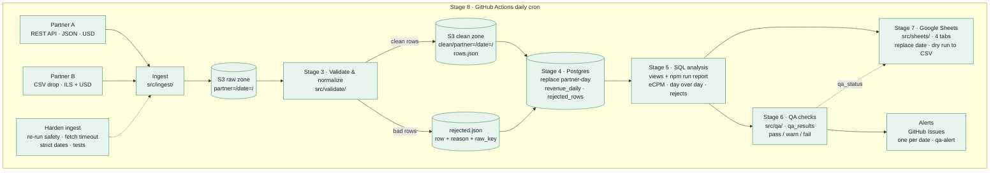

# Architecture

The pipeline runs once a day. It collects yesterday's revenue reports from each partner, keeps the raw files,
cleans and validates them, loads them into Postgres, checks the result, and publishes a daily summary.

Green is built, orange should be fixed before moving on, blue is next, and grey dashed is later.

## Components

| Component | Code | Status | Responsibility |
|---|---|---|---|
| Mock partners | `src/mock-partners/` | ✅ Built | Seeded, reproducible reports with deliberate data problems |
| Ingest | `src/ingest/` | ✅ Built, hardened | Fetch or pick up each partner's report and store it unchanged in S3; safe to re-run, partner A calls time out |
| Date helpers | `src/lib/dates.ts` | ✅ Built | Strict ISO and `DD/MM/YYYY` parsing; impossible days rejected |
| Tests | `src/**/*.test.ts` | ✅ Built | `npm test` (`node --test` + `tsx`), mock partners as fixtures |
| S3 raw zone | `src/lib/s3.ts` | ✅ Built | Append-only store, partitioned by partner and date, deduplicated by sha256 |
| S3 clean zone | `src/lib/s3.ts` | ✅ Built | `clean/partner=/date=/rows.json` and `rejected.json`, fixed keys so re-runs overwrite |
| Validate & normalize | `src/validate/` | ✅ Built | Map both formats to one canonical row from the latest raw file; write clean and rejected rows (with reason) to the S3 `clean/` zone, overwritten per partner-day |
| FX | `src/lib/fx.ts` | ✅ Built (fixed rate) | ILS→USD via `loadFxRates(date)`; fixed `FX_ILS_PER_USD` until a daily source is chosen |
| Postgres schema | `db/migrations/`, `src/lib/migrate.ts` | ✅ Built | Plain SQL migrations recorded in `schema_migrations`; `npm run migrate` |
| Postgres load | `src/load/`, `src/lib/db.ts` | ✅ Built | Read the clean zone; per partner-day, one transaction deletes and re-inserts `revenue_daily` and `rejected_rows`; refuses files with mismatched `raw_key` |
| SQL analysis | `db/migrations/002_analysis_views.sql`, `src/report/` | ✅ Built | Views for daily totals, revenue and eCPM by partner, site and ad unit, partner day-over-day, and reject share; `npm run report` prints one day (query and formatting kept separate for stage 7) |
| QA checks & alerts | `src/qa/`, `db/migrations/003_qa.sql` | ✅ Built | Pure checks over the stage 5 views (missing partner-day, reject share, day-over-day swing, zero totals) with env thresholds; results replace the date in `qa_results`; `npm run qa` exits non-zero on a fail; alerts as one GitHub Issue per date (comment if open, close on pass), sent only when `QA_ALERTS=github`, otherwise a dry run |
| Google Sheets | `src/sheets/` | ✅ Built (dry run until connected) | `npm run sheets` writes `Daily`, `By partner`, `By site`, `By ad unit` tabs from `fetchDailyReport` plus the worst `qa_results` status; each run reads the tabs, replaces the date's rows, sorts by date and writes back in one request. Service-account JWT (RS256, `node:crypto`) + Sheets API v4 with `fetch`, no dependency. Google only when `SHEETS_MODE=google`; otherwise the same merge into `out/sheets/*.csv` |
| Scheduler | `.github/workflows/daily.yml` | ✅ Built | Run the whole chain every day (demo mode with job services until hosted secrets are set) |
| CI | `.github/workflows/ci.yml` | ✅ Built | Typecheck and tests, including Postgres integration, on every PR |

## Canonical row (stage 3 output)

| Column | Type | Notes |
|---|---|---|
| `date` | date | Partner B's `DD/MM/YYYY` converted to ISO; impossible dates rejected |
| `partner` | text | `a`, `b` |
| `site` | text | Trimmed and lowercased |
| `ad_unit` | text | `top_banner`, `sidebar`, `video_mid` |
| `impressions` | integer | Negative or missing values rejected |
| `revenue_usd` | numeric | Currency symbols stripped; ILS converted to USD at `FX_ILS_PER_USD` (fixed for now) |
| `raw_key` | text | S3 key of the source file, for lineage |

## Warehouse tables (stage 4)

| Table | Key | Columns |
|---|---|---|
| `revenue_daily` | `(partner, date, site, ad_unit)` | canonical row + `fx_source`, `loaded_at`; `revenue_usd NUMERIC(18,6)` |
| `rejected_rows` | `id`, indexed on `(partner, date)` | `partner, date, reason, detail, raw_key, line, original_row JSONB, loaded_at` |
| `schema_migrations` | `version` | applied migration files |
| `qa_results` (stage 6) | `id`, unique on `(date, check, partner)` | `status` (pass/warn/fail), `message`, `details JSONB`, `checked_at`; replaced per date |

## Analysis views (stage 5)

| View | Grain | Notes |
|---|---|---|
| `v_daily_totals` | date | revenue, impressions, eCPM, partner and row counts |
| `v_daily_by_partner` / `_by_site` / `_by_ad_unit` | date + dimension | revenue, impressions, eCPM |
| `v_partner_day_over_day` | date, partner | change vs `date - 1` only (absolute and %), via `LAG` |
| `v_reject_summary` | date, partner, reason | counts and share of rows received (`rejected / (rejected + loaded)`) |

eCPM is `analysis_ecpm(revenue, impressions)` = `revenue * 1000 / NULLIF(impressions, 0)`, so it is `NULL` when impressions are 0.

## Work order

1. ✅ **Harden ingest.**
   - Treat an already-processed Partner B file as unchanged instead of failing (`src/ingest/partner-b.ts`).
   - Add a timeout to the Partner A fetch (`src/ingest/partner-a.ts`).
   - Move date helpers to `src/lib/dates.ts` with strict parsing.
   - Add a `test` script.
2. ✅ **Stage 3: validate and normalize.** Built with a fixed ILS→USD rate (`FX_ILS_PER_USD`) and a configurable reporting timezone (`REPORT_TZ`, Israel time). The fixed rate is good enough for now.
3. ✅ **Stage 4: Postgres load.** `pg`, a plain SQL migration and runner, and `npm run load`. Each partner-day is replaced in one transaction (delete + insert), so re-runs never duplicate revenue.
4. ✅ **Stage 5: SQL analysis.** Re-runnable views in `002_analysis_views.sql` (eCPM `NULL` on 0 impressions, day-over-day against the previous calendar day, reject share) and `npm run report -- <date>`.
5. ✅ **Stage 6: QA checks and alerts.** `npm run qa -- <date>` checks the day through `fetchDailyReport`, stores results in `qa_results` (`003_qa.sql`), and exits non-zero on a fail. Alerts are GitHub Issues (the user's choice) via the REST API with `fetch`, deduplicated by title, and only sent when `QA_ALERTS=github`.
6. ✅ **Stage 7: Google Sheets.** `npm run sheets -- <date>` reuses `fetchDailyReport` and the worst `qa_results` status, and replaces the date's rows in four tabs (read, merge, write back). Service-account auth and the Sheets REST API with `fetch`, no dependency. A dry run to `out/sheets/*.csv` until `SHEETS_MODE=google` with `SHEETS_SPREADSHEET_ID` and `GOOGLE_SERVICE_ACCOUNT_JSON`.
7. ✅ **Stage 8: daily schedule.**
   - **`.github/workflows/daily.yml`** runs the whole chain at 05:00 UTC, or on demand with a date.
     - Demo mode (default): Postgres and S3Mock run as job services, so the data doesn't persist between runs.
     - Hosted mode: setting the `DATABASE_URL`, `S3_ENDPOINT` and AWS key secrets switches to hosted services without any code change.
     - QA alerts are real GitHub Issues (`issues: write`). Sheets runs even when QA fails, and uploads the CSVs as an artifact until the Google secret is set.
   - **`.github/workflows/ci.yml`** runs the typecheck and tests, including the Postgres integration suites, on every PR and on every push to master.
